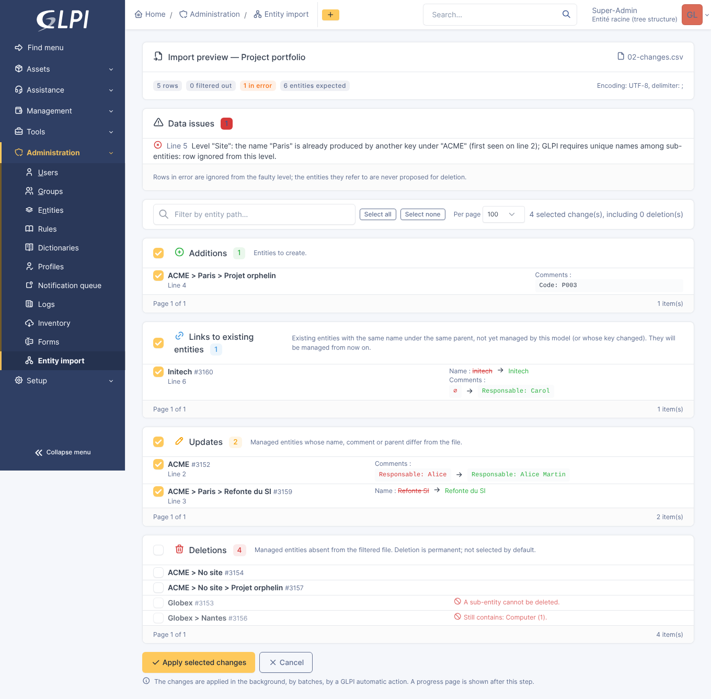

# Entity Sync — GLPI plugin

Synchronize the GLPI entity tree below a target entity from a CSV file. Every
addition, link, update and deletion is shown in a preview panel and applied only
when selected.

- **GLPI**: 11.0.x (tested with 11.0.0 and 11.0.11)
- **PHP**: 8.2+ (as required by GLPI 11)
- **License**: GPL-3.0-or-later



## Features

- **Import models**: target root entity, CSV options, ordered levels and a filter.
- **Levels** built from one or more key columns, with an optional name column,
  regular-expression replacement rules on the name, and a comment made of
  `Label: value` lines taken from columns.
- **Intermediate entities** created once (`ACME`, `ACME > Paris`,
  `ACME > Paris > Project`), and a configurable placeholder for empty values in the
  middle of a path (`ACME > No site > Project`).
- **Filter**: conditions on columns combined with AND / OR / NOT, with text, list,
  numeric, date, regular-expression and emptiness operators.
- **Preview panel**: additions, links to existing entities, updates and deletions to
  select, page by page, with a server-side search, *select all* across pages and
  automatic handling of dependencies.
- **Background application by batches** through a GLPI automatic action, with a
  progress page: tested with 1,320 operations; requires GLPI's cron to be run by the
  system.
- **Safety**: only entities managed by the model can be changed or deleted, deletions
  are blocked while an entity still holds items, deletions are not selected by
  default, GLPI rights are enforced.
- **History** of every applied import, fr_FR and en_GB translations.

## Documentation

| | English | Français |
|---|---|---|
| User guide | [docs/en/user-guide.md](docs/en/user-guide.md) | [docs/fr/guide-utilisateur.md](docs/fr/guide-utilisateur.md) |
| Installation and configuration | [docs/en/installation.md](docs/en/installation.md) | [docs/fr/installation.md](docs/fr/installation.md) |
| Developer guide | [docs/developer.md](docs/developer.md) | |

## Quick installation

Download `entitysync-<version>.tar.gz` from the releases, extract it into GLPI's
`plugins/` directory, then install and enable it in *Setup > Plugins*, or:

```sh
php bin/console plugin:install entitysync --username=<admin login>
php bin/console plugin:activate entitysync
```

Then make sure GLPI's cron is run by the system every minute
(`* * * * * php /var/www/glpi/front/cron.php`, as the web server user): imports are
applied by the automatic action `entitysyncApply`.

The menu entry is *Administration > Entity import*. See the
[installation guide](docs/en/installation.md) for rights and model configuration.

## Development

Open the repository in its dev container: GLPI and the plugin are installed
automatically and served on <http://localhost:8080> (`glpi` / `glpi`).

```sh
make check      # lint, unit tests, translation checks
make e2e        # end-to-end scenario against the running GLPI
make package    # deployable archive in dist/
```

See the [developer guide](docs/developer.md).
