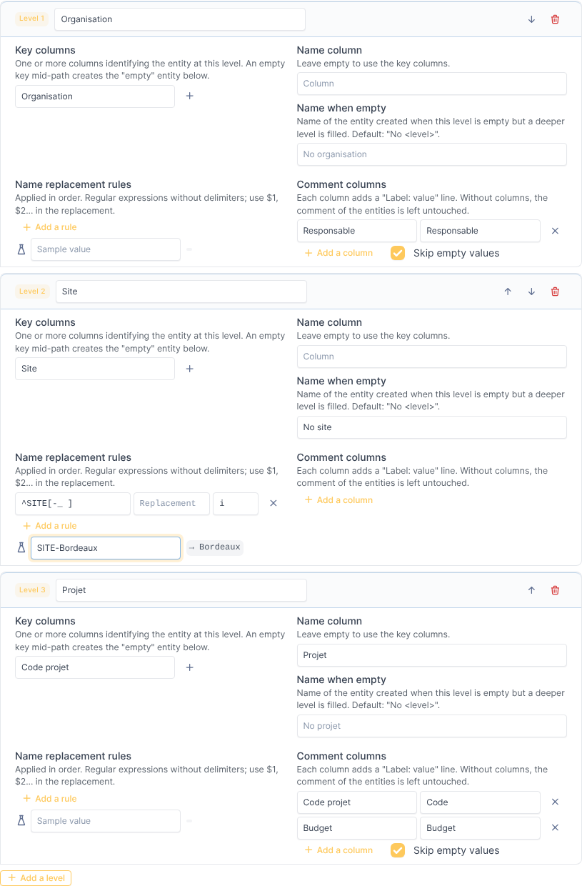
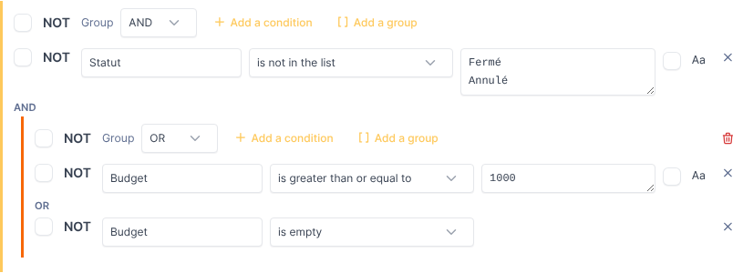

# Entity Sync — Installation and configuration guide

*[Version française](../fr/installation.md)*

This guide is for GLPI administrators: installing the plugin, granting rights, and
configuring import models. Running imports is described in the
[user guide](user-guide.md).

- [Requirements](#requirements)
- [Installation](#installation)
- [Upgrade](#upgrade)
- [Uninstallation](#uninstallation)
- [Server settings](#server-settings)
- [Rights](#rights)
- [Configuring an import model](#configuring-an-import-model)
- [Worked example](#worked-example)
- [Before the first import](#before-the-first-import)
- [Troubleshooting](#troubleshooting)

## Requirements

| Component | Version |
|---|---|
| GLPI | 11.0.x (tested with 11.0.0 and 11.0.11) |
| PHP | The versions supported by your GLPI release (8.2 or later), with the `mbstring` and `intl` extensions (already required by GLPI) |
| Database | The one used by GLPI (MariaDB or MySQL) |

## Installation

1. Download `entitysync-<version>.tar.gz` from the releases page of the repository,
   and optionally check it against the `.sha256` file:

   ```sh
   sha256sum -c entitysync-<version>.tar.gz.sha256
   ```

2. Extract it into the `plugins/` directory of GLPI. The directory **must** be named
   `entitysync`:

   ```sh
   tar -xzf entitysync-<version>.tar.gz -C /var/www/glpi/plugins/
   chown -R www-data:www-data /var/www/glpi/plugins/entitysync   # web server user
   ```

3. Install and activate the plugin, either in *Setup > Plugins* (buttons *Install*
   then *Enable*), or with the console, run as the web server user:

   ```sh
   cd /var/www/glpi
   sudo -u www-data php bin/console plugin:install entitysync --username=<admin login>
   sudo -u www-data php bin/console plugin:activate entitysync
   ```

The installation creates three tables (`glpi_plugin_entitysync_models`, `_links`,
`_runs`) and the plugin right. Profiles that can update the GLPI configuration
(Super-Admin by default) receive all the plugin rights; the other profiles receive
none.

The menu entry is *Administration > Entity import*.

## Upgrade

1. Replace the `plugins/entitysync` directory with the new version (keep the same
   directory name).
2. In *Setup > Plugins*, the plugin is shown as to be updated: run the update, then
   enable it. With the console:

   ```sh
   sudo -u www-data php bin/console plugin:install entitysync --username=<admin login> --force
   sudo -u www-data php bin/console plugin:activate entitysync
   ```

Models, managed entities and history are kept.

## Uninstallation

Uninstalling the plugin (*Setup > Plugins > Uninstall*) drops its tables and rights:
models, links between models and entities, and the import history are lost. **The
entities created by the plugin stay in GLPI** as ordinary entities.

## Server settings

| Setting | Why |
|---|---|
| `upload_max_filesize`, `post_max_size` (PHP) | Maximum size of the CSV file. The Import tab shows the current limit. |
| `memory_limit` (PHP) | The whole file is loaded in memory. As an order of magnitude, the engine used about 110 MB for 50,000 rows in a test (estimate, depends on the number of columns). |
| Web server timeouts | Applying an import writes entities one by one through GLPI (about 6 ms per entity measured on a test instance). The plugin lifts PHP's `max_execution_time` while applying, but not the timeouts of the web server or proxy (`fastcgi_read_timeout` for nginx, `Timeout`/`ProxyTimeout` for Apache, `request_terminate_timeout` for PHP-FPM). Raise them for imports of several thousand entities. |
| `files/_tmp` (GLPI) | The uploaded file is kept there between the preview and the application. It must be writable by the web server (it already is for GLPI). |

## Rights

The plugin adds an **Entity import** tab to profiles (*Administration > Profiles >
(profile) > Entity import*):

| Right | Allows |
|---|---|
| Read | See the models, their managed entities and their history |
| Create / Update / Delete permanently | Manage the models |
| Apply an import | Upload a file, preview and apply changes |

Applying an import also checks the user's rights on **entities**:

| Operation | Required entity right |
|---|---|
| Addition | Create and Update |
| Link, update | Update |
| Deletion | Delete permanently |

and requires a **recursive** access to the target root entity of the model. The
preview shows the operations the user is not allowed to apply as blocked, with the
reason.

## Configuring an import model

Create a model in *Administration > Entity import > Add*. The form has four parts.

### General

| Field | Description |
|---|---|
| Name | Name of the model. |
| Target root entity | The entities are created and managed below this entity. It can be the root entity or any sub-entity. |
| Comments | Free text. |

### CSV file

| Field | Description |
|---|---|
| Delimiter | *Automatic* (detected on the first line among `;`, `,`, tab and `\|`), or fixed. |
| Encoding | *Automatic* (UTF-8 if the file is valid UTF-8, Windows-1252 otherwise), or fixed (UTF-8, Windows-1252, ISO-8859-1, ISO-8859-15). A UTF-8 BOM is ignored. |
| Text delimiter | Character surrounding values that contain the delimiter (default `"`). A quote inside a value is written twice. |

The first row of the file must contain the column names. They must be unique and not
empty. Values are trimmed and blank lines are ignored. Column names are case
sensitive; once a file has been uploaded, the editors suggest its column names.

### Levels



Levels are ordered from the top (level 1, directly below the target root entity) to
the bottom. Use the arrows to reorder them.

| Setting | Description |
|---|---|
| Level label | Name of the level, used in messages and in the default name of empty values. |
| Key columns | One or more columns identifying the entity at this level. With several columns (for example *Country* + *City*), the key is the combination of their values. The key must be stable over time: when it changes, the plugin sees a different entity. |
| Name column | Column giving the name of the entity in GLPI. Empty: the key values, joined with ` - `. If the name column is empty on a row, the key is used. |
| Name when empty | Name of the entity created when this level is empty on a row but a deeper level is filled. Default: *No &lt;level&gt;* (for example *No site*). |
| Name replacement rules | Regular expressions applied in order to the name (see below). |
| Comment columns | Each column adds a `Label: value` line to the comment of the entity, in the order of the list. *Skip empty values* omits the lines whose value is empty. **Without comment columns, the plugin does not manage the comment**: existing comments are never overwritten. |

**Replacement rules.** Each rule has a *pattern*, a *replacement* and optional
*flags*. The pattern is a PCRE regular expression written **without delimiters**; the
flags are among `i` (case insensitive), `m`, `s`, `x` and `U`; Unicode is always
enabled. The replacement can reuse captured groups with `$1`, `$2`... Spaces are
normalized after the rules (no double spaces, no leading or trailing space). The
*Sample value* field below the rules shows the result as you type (computed by the
browser, which may differ from the server for advanced syntax).

| Goal | Pattern | Flags | Replacement | Example |
|---|---|---|---|---|
| Remove a prefix | `^SITE[-_ ]` | `i` | *(empty)* | `site_Lyon` → `Lyon` |
| Remove a code in parentheses | `\s*\([^)]*\)$` | | *(empty)* | `Paris Nord (PAR01)` → `Paris Nord` |
| Reorder parts | `^(\S+) - (.+)$` | | `$2 ($1)` | `FR75 - Paris` → `Paris (FR75)` |
| Underscores to spaces | `_` | | ` ` *(a space)* | `Data_Center_Est` → `Data Center Est` |
| Remove leading zeros | `^0+` | | *(empty)* | `00042` → `42` |

A name that is empty after the rules, or longer than 255 characters, puts the row in
error.

### Filter



The filter selects the rows of the file to import. It is a tree of **groups** and
**conditions**:

- a group combines its children with **AND** or **OR**; *Add a group* nests a group,
  for example *A AND (B OR C)*;
- **NOT** negates a group or a condition;
- a condition compares a **column** with one or more **values** (one per line) using
  an **operator**; *Aa* makes it case sensitive (insensitive by default).

| Operator | True when the cell... |
|---|---|
| equals / is different from | is equal / not equal to the value (numeric comparison when both are numbers) |
| is in the list / is not in the list | is one of / none of the values |
| contains / does not contain | contains / does not contain the value |
| starts with / ends with | starts / ends with the value |
| matches the regular expression | matches the PCRE expression (without delimiters) |
| is greater / less than (or equal to) | compares as numbers when both are numbers (`1,5` and `1.5` accepted), as dates for `YYYY-MM-DD` and `DD/MM/YYYY` (with an optional time), as text otherwise |
| is empty / is not empty | is empty / not empty (no value needed; a missing column counts as empty) |

With several values, a positive operator is true when **any** value matches; a
negative operator (*is different from*, *is not in the list*, *does not contain*) is
true when **no** value matches. A filter without conditions keeps every row.

**Rows removed by the filter count as absent from the file**: the entities they used
to produce are proposed for deletion. Change a filter with care on a model that is
already in use.

The model is validated when saved: missing key columns, invalid regular expressions or
incomplete conditions are reported and the model is not saved. Column names are
checked against the file at each import.

## Worked example

File `projects.csv`:

```csv
Organisation;Site;Code projet;Projet;Responsable;Budget;Statut
ACME;SITE-Paris;P001;Migration K8s;Alice;5000;Actif
ACME;SITE-Paris;P002;Refonte SI;Alice;1500;Actif
ACME;;P003;Projet orphelin;Alice;;Actif
ACME;site_Lyon;P004;Datacenter;Alice;20000;Fermé
Globex;Nantes;;;Bob;;Actif
Globex;Nantes;P005;Petit projet;Bob;200;Actif
```

Model (the configuration shown in the screenshots above):

| Level | Key | Name | Rules | Comment |
|---|---|---|---|---|
| Organisation | `Organisation` | (key) | | `Responsable` |
| Site | `Site` | (key) | `^SITE[-_ ]` → *(empty)*, flag `i` | |
| Projet | `Code projet` | `Projet` | | `Code projet` (label *Code*), `Budget` |

Filter: `Statut` *is not in the list* `Fermé`, `Annulé` **AND** (`Budget` *is greater
than or equal to* `1000` **OR** `Budget` *is empty*).

Result below the target root entity:

```text
ACME                               Responsable: Alice
├── No site
│   └── Projet orphelin            Code: P003
└── Paris
    ├── Migration K8s              Code: P001 / Budget: 5000
    └── Refonte SI                 Code: P002 / Budget: 1500
Globex                             Responsable: Bob
└── Nantes
```

Line 5 (`Fermé`) and line 7 (budget 200) are removed by the filter; line 4 has no site,
so *No site* is created; line 6 has no project, so it stops at *Nantes*.

## Before the first import

- Try the model on a test instance, or with a test target root entity, before using
  it on the production tree.
- If the tree already exists in GLPI, check the *Links* section of the first preview:
  existing entities with the same names are adopted instead of being duplicated.
- Give the *Apply an import* right only to the people in charge of the reference
  data.

## Troubleshooting

| Symptom | Cause and solution |
|---|---|
| *Level "X": column "Y" does not exist in the file* | Column names are case sensitive and must match the header exactly. Check the delimiter if the whole header is read as one column. |
| Accented characters are garbled | Set the encoding of the model explicitly (Windows-1252 for files saved by Excel on Windows, for example). |
| *You need a recursive access to the target root entity* | Switch to the target entity (or a parent) with the *recursive* option in the entity selector, or grant the profile on that entity recursively. |
| *This import has expired or was already applied* | The preview was already applied or cancelled, or the session expired. Upload the file again. |
| A deletion is blocked: *Still contains...* | The entity still holds items (computers, tickets, user authorizations...). Move or delete them, then import again. |
| A row is in error: *the name "X" is already produced by another key* | Two different keys give the same name under the same parent, which GLPI forbids. Fix the source data, or change the name column or the rules. |
| The entity is not adopted: *already managed by another import model* | Two models target the same entities. Each entity can be managed by one model only. |
| The import stops with a timeout | See [server settings](#server-settings), or apply the changes in several passes: select part of them (the search field of the preview helps, for example one organisation), apply, then import the same file again for the rest. Do not split the file itself: rows absent from a file are proposed for deletion. |
