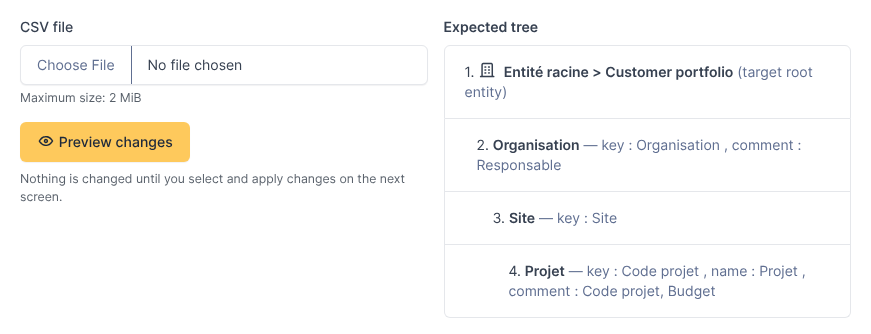
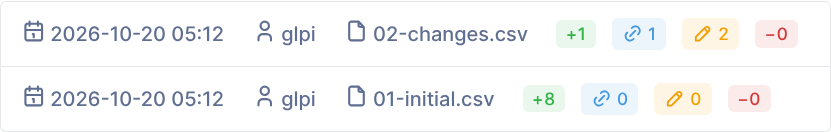
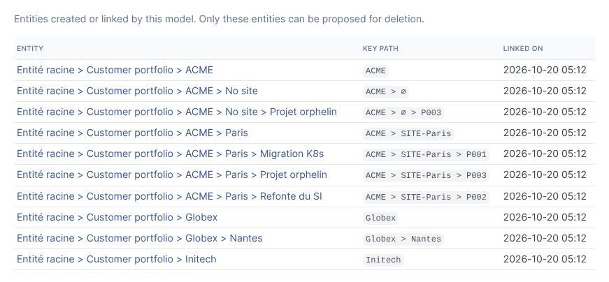

# Entity Sync — User guide

*[Version française](../fr/guide-utilisateur.md)*

This guide is for the people who run imports. Setting up the plugin and the import
models is covered in the [installation and configuration guide](installation.md).

- [Concepts](#concepts)
- [Running an import](#running-an-import)
- [Reading the preview](#reading-the-preview)
- [Selecting and applying changes](#selecting-and-applying-changes)
- [After the import](#after-the-import)
- [How changes are detected](#how-changes-are-detected)
- [Common situations](#common-situations)
- [Good practices](#good-practices)

## Concepts

**Import model.** A model describes how a CSV file becomes a tree of entities: under
which GLPI entity the tree is built (the *target root entity*), which columns make
each level, how names and comments are computed, and which rows are kept. Models are
listed in *Administration > Entity import*.

**Levels.** Each level below the target root entity comes from one or more columns
of the file. With the levels *Organisation*, *Site* and *Project*, a row
`ACME;Paris;Migration` produces three entities: `ACME`, `ACME > Paris` and
`ACME > Paris > Migration`. Intermediate entities are created once and shared by all
the rows that use them.

**Key.** At each level, the *key* identifies the entity: one or more columns whose
values do not change over time (a code, an identifier). The name shown in GLPI can
come from another column and can change; the key cannot, otherwise the plugin sees
a different entity.

**Managed entity.** An entity created or adopted by a model. Only managed entities
can be updated or deleted by that model; the other entities of GLPI are never
touched, except when the plugin proposes to adopt one (see below).

**Nothing is written before you confirm.** Uploading a file only computes a
*preview*. You choose the changes to apply, then confirm.

## Running an import

1. Open the model in *Administration > Entity import*.
2. Go to the **Import** tab. The right-hand side reminds the expected structure of
   the file (levels and columns).
3. Choose the CSV file and click **Preview changes**.

The file must have a header row with the column names expected by the model. If a
column is missing or the file cannot be read, an error page lists the problems; fix
the file (or ask the model administrator) and upload it again.

> You need the *Apply an import* right on the plugin, the matching rights on
> entities, and a recursive access to the target root entity. Without them, the Import
> tab shows a message or the operations appear as blocked.

## Reading the preview

**Summary.** The first card shows the number of rows in the file, the rows removed
by the model's filter, the rows in error, and the number of entities the file
describes.

**Data issues.** Problems found in the file, with their line numbers:

| Kind | Meaning | Effect |
|---|---|---|
| Error (red) | The row cannot be used from a given level: name empty after the replacement rules, name longer than 255 characters, or two different keys producing the same name under the same parent (GLPI forbids two sub-entities with the same name). | The row is ignored from that level. The entities it refers to are **never** proposed for deletion. |
| Warning (orange) | Several rows describe the same entity with different names or comments, or a row has no key at all. | The first row wins; the other lines are listed. |

**Changes.** Four sections, each with a checkbox per change:

| Section | Content | Selected by default |
|---|---|---|
| Additions | Entities to create. Their comment is shown. | Yes |
| Links to existing entities | Entities that already exist with the same name under the expected parent, not managed yet by this model: the plugin proposes to adopt them (instead of creating a duplicate) and shows the field changes. Also used when the key of a managed entity changed but its name did not. | Yes |
| Updates | Managed entities whose name, comment or parent differ from the file. The old value is struck through, the new one is shown in green. | Yes |
| Deletions | Managed entities that are no longer in the file (after filtering). Deletion is permanent. | **No** |

A change can be **blocked**: its checkbox is disabled and the reason is shown in red.
For example, an entity that still contains computers, tickets or users cannot be
deleted, nor an entity that has sub-entities not proposed for deletion; a creation is
blocked if its name is already used by another entity under the same parent.

## Selecting and applying changes

- Check or uncheck changes one by one, by section (checkbox in the section header),
  or with **Select all** / **Select none**.
- The search field filters the list by entity path; *Select all* and *Select none*
  apply to the visible rows only.
- **Dependencies are handled for you.** Selecting the creation of
  `ACME > Paris > Migration` also selects the creation of `ACME` and `ACME > Paris`
  if they are new. Unselecting `ACME` unselects everything that needs it. Deleting an
  entity selects the deletion of its managed sub-entities. The counter at the top
  shows how many changes are selected, including how many deletions.
- Click **Apply selected changes**. When deletions are selected, a confirmation is
  asked first.
- **Cancel** drops the uploaded file without changing anything.

The plugin recomputes the changes when you apply them. If someone changed GLPI in
the meantime, the result reflects the current state, and the summary message tells
you if some selected changes no longer applied.

## After the import

A message summarizes what was done. The **Import runs** tab keeps the history of the
last 50 imports of the model: date, user, file, counters, and the result of every
operation (done, failed with the reason, or skipped because an operation it depended
on was not applied).

The **Managed entities** tab lists the entities the model is responsible for, with
their key path (`∅` marks an empty value, see below).

## How changes are detected

The identity of an entity is its **key path**: the keys of each level, from the top
level down to the entity (for example `ACME > SITE-Paris > P001`).

| In the file | In GLPI | Proposed change |
|---|---|---|
| Key path already managed | Same name, comment and parent | Nothing |
| Key path already managed | Name, comment or parent differ | Update (the plugin also puts back an entity that was moved by hand) |
| New key path | An entity with the same name exists under the expected parent | Link (adoption) |
| New key path | No such entity | Addition |
| Key path no longer present (or filtered out) | Managed entity | Deletion (not selected by default, blocked when the entity is not empty) |

Name comparisons ignore case and accents, as GLPI does. Comments are only managed
when the model defines comment columns; otherwise GLPI comments are left as they are.

**Empty values.** When a level is empty but a deeper level is filled (a project with
no site), the plugin creates an intermediate entity named after the level, for
example `ACME > No site > Migration`. When the last levels are empty, the row simply
stops earlier (`ACME;Paris;` gives `ACME > Paris`).

## Common situations

**A name changes in the source, the key does not.** The entity is updated (renamed);
its content (computers, tickets...) stays attached.

**A key changes.** If the name is the same under the same parent, the entity is
re-linked to the new key (*Links* section, "Key changed"). Otherwise the plugin
proposes to delete the old entity and to create a new one: check that nothing is
attached to the old one, or keep the key stable in the source.

**A project moves to another site.** Its key path changes (the site is part of it):
the plugin proposes the creation of the project under the new site and the deletion
of the old one. If the old entity contains items, its deletion is blocked: move the
items in GLPI first, or keep the old entity.

**Someone renamed or moved a managed entity by hand in GLPI.** The next import
proposes to put it back as described in the file. Uncheck the update to keep the
manual change for this time; to keep it for good, change the source file.

**A row disappears because of the model's filter.** It is treated as absent: its
entities are proposed for deletion.

**The first import on an existing tree.** Entities that already exist with the same
names are proposed in *Links*: the plugin adopts them instead of creating duplicates.
Review this section carefully.

**An entity is already managed by another model.** It is not adopted (blocked), to
avoid two models fighting over the same entity.

**Nothing to change.** When GLPI already matches the file, the preview says so and
no import run is recorded.

## Good practices

- Use stable codes as keys and put the display names in a separate *name* column.
- Read the *Data issues* card before applying: rows in error are partly ignored.
- Keep deletions unselected until you have checked them; blocked deletions show
  what is still attached.
- Apply the first import of a new model on a test instance or under a test target
  entity, then check the result in the *Managed entities* tab.
