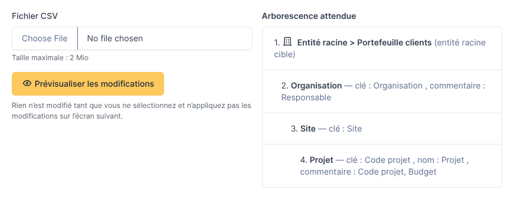
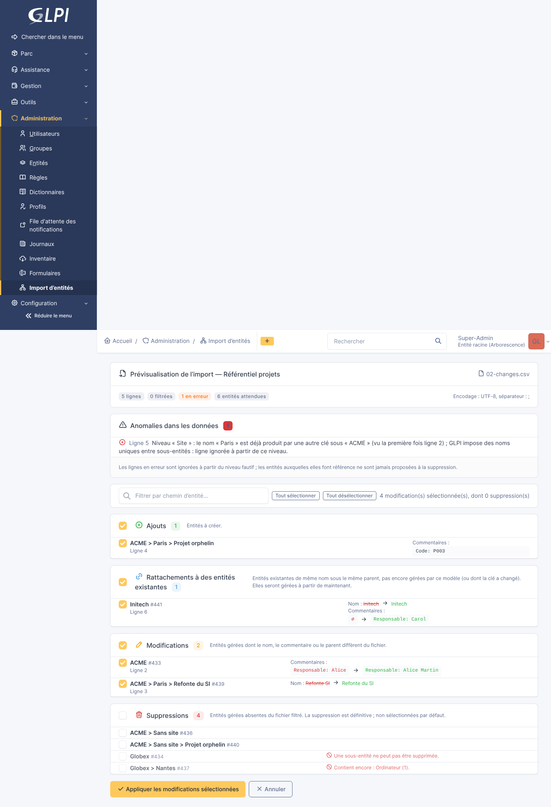
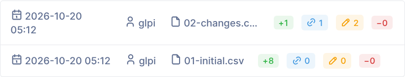
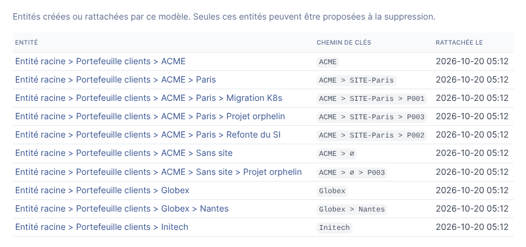

# Entity Sync — Guide utilisateur

*[English version](../en/user-guide.md)*

Ce guide s'adresse aux personnes qui lancent les imports. L'installation du plugin et
le paramétrage des modèles d'import sont décrits dans le
[guide d'installation et de paramétrage](installation.md).

- [Notions](#notions)
- [Lancer un import](#lancer-un-import)
- [Lire la prévisualisation](#lire-la-prévisualisation)
- [Sélectionner et appliquer les modifications](#sélectionner-et-appliquer-les-modifications)
- [Après l'import](#après-limport)
- [Comment les modifications sont détectées](#comment-les-modifications-sont-détectées)
- [Cas fréquents](#cas-fréquents)
- [Bonnes pratiques](#bonnes-pratiques)

## Notions

**Modèle d'import.** Un modèle décrit comment un fichier CSV devient une arborescence
d'entités : sous quelle entité GLPI l'arborescence est construite (l'*entité racine
cible*), quelles colonnes forment chaque niveau, comment les noms et les commentaires
sont calculés, et quelles lignes sont conservées. Les modèles sont listés dans
*Administration > Import d'entités*.

**Niveaux.** Chaque niveau sous l'entité racine cible provient d'une ou plusieurs
colonnes du fichier. Avec les niveaux *Organisation*, *Site* et *Projet*, la ligne
`ACME;Paris;Migration` produit trois entités : `ACME`, `ACME > Paris` et
`ACME > Paris > Migration`. Les entités intermédiaires sont créées une seule fois et
partagées par toutes les lignes qui les utilisent.

**Clé.** À chaque niveau, la *clé* identifie l'entité : une ou plusieurs colonnes dont
les valeurs ne changent pas dans le temps (un code, un identifiant). Le nom affiché
dans GLPI peut venir d'une autre colonne et peut changer ; la clé non, sinon le plugin
voit une autre entité.

**Entité gérée.** Une entité créée ou rattachée par un modèle. Seules les entités gérées
peuvent être modifiées ou supprimées par ce modèle ; les autres entités de GLPI ne sont
jamais touchées, sauf quand le plugin propose d'en rattacher une (voir plus bas).

**Rien n'est écrit avant votre confirmation.** L'envoi d'un fichier calcule seulement
une *prévisualisation*. Vous choisissez les modifications à appliquer, puis vous
confirmez.

## Lancer un import

1. Ouvrez le modèle dans *Administration > Import d'entités*.
2. Allez dans l'onglet **Import**. La partie droite rappelle la structure attendue du
   fichier (niveaux et colonnes).
3. Choisissez le fichier CSV et cliquez sur **Prévisualiser les modifications**.

Le fichier doit avoir une ligne d'en-tête avec les noms de colonnes attendus par le
modèle. Si une colonne manque ou si le fichier est illisible, une page d'erreur liste
les problèmes ; corrigez le fichier (ou demandez à l'administrateur du modèle) et
renvoyez-le.

> Il faut le droit *Appliquer un import* sur le plugin, les droits correspondants sur
> les entités et un accès récursif à l'entité racine cible. Sans eux, l'onglet Import
> affiche un message ou les opérations apparaissent bloquées.

## Lire la prévisualisation

**Synthèse.** La première carte indique le nombre de lignes du fichier, les lignes
écartées par le filtre du modèle, les lignes en erreur et le nombre d'entités décrites
par le fichier.

**Anomalies dans les données.** Problèmes détectés dans le fichier, avec leur numéro de
ligne :

| Type | Signification | Effet |
|---|---|---|
| Erreur (rouge) | La ligne est inutilisable à partir d'un niveau : nom vide après les règles de remplacement, nom de plus de 255 caractères, ou deux clés différentes qui produisent le même nom sous le même parent (GLPI interdit deux sous-entités de même nom). | La ligne est ignorée à partir de ce niveau. Les entités auxquelles elle fait référence ne sont **jamais** proposées à la suppression. |
| Avertissement (orange) | Plusieurs lignes décrivent la même entité avec des noms ou des commentaires différents, ou une ligne n'a aucune clé. | La première ligne l'emporte ; les autres lignes sont listées. |

**Modifications.** Quatre sections, avec une case à cocher par modification :

| Section | Contenu | Cochée par défaut |
|---|---|---|
| Ajouts | Entités à créer. Leur commentaire est affiché. | Oui |
| Rattachements à des entités existantes | Entités qui existent déjà avec le même nom sous le parent attendu, pas encore gérées par ce modèle : le plugin propose de les rattacher (plutôt que de créer un doublon) et affiche les champs modifiés. Sert aussi quand la clé d'une entité gérée a changé mais pas son nom. | Oui |
| Modifications | Entités gérées dont le nom, le commentaire ou le parent diffèrent du fichier. L'ancienne valeur est barrée, la nouvelle est en vert. | Oui |
| Suppressions | Entités gérées absentes du fichier (après filtrage). La suppression est définitive. | **Non** |

Une modification peut être **bloquée** : sa case est désactivée et la raison est
affichée en rouge. Par exemple, une entité qui contient encore des ordinateurs, des
tickets ou des utilisateurs ne peut pas être supprimée, pas plus qu'une entité qui a des
sous-entités non proposées à la suppression ; une création est bloquée si son nom est
déjà utilisé par une autre entité sous le même parent.

## Sélectionner et appliquer les modifications

- Cochez ou décochez les modifications une par une, par section (case de l'en-tête de
  section), ou avec **Tout sélectionner** / **Tout désélectionner**.
- Le champ de recherche filtre la liste par chemin d'entité ; *Tout sélectionner* et
  *Tout désélectionner* ne portent que sur les lignes visibles.
- **Les dépendances sont gérées pour vous.** Cocher la création de
  `ACME > Paris > Migration` coche aussi la création de `ACME` et de `ACME > Paris` si
  elles sont nouvelles. Décocher `ACME` décoche tout ce qui en dépend. Supprimer une
  entité coche la suppression de ses sous-entités gérées. Le compteur en haut indique
  le nombre de modifications sélectionnées, dont le nombre de suppressions.
- Cliquez sur **Appliquer les modifications sélectionnées**. Si des suppressions sont
  sélectionnées, une confirmation est demandée.
- **Annuler** abandonne le fichier envoyé sans rien modifier.

Le plugin recalcule les modifications au moment de les appliquer. Si quelqu'un a
modifié GLPI entre-temps, le résultat tient compte de l'état actuel, et le message de
synthèse signale les modifications sélectionnées qui ne s'appliquaient plus.

## Après l'import

Un message résume ce qui a été fait. L'onglet **Exécutions d'import** conserve
l'historique des 50 derniers imports du modèle : date, utilisateur, fichier, compteurs
et résultat de chaque opération (faite, en échec avec la raison, ou ignorée parce
qu'une opération dont elle dépendait n'a pas été appliquée).

L'onglet **Entités gérées** liste les entités dont le modèle est responsable, avec leur
chemin de clés (`∅` signale une valeur vide, voir plus bas).

## Comment les modifications sont détectées

L'identité d'une entité est son **chemin de clés** : les clés de chaque niveau, du
premier niveau jusqu'à l'entité (par exemple `ACME > SITE-Paris > P001`).

| Dans le fichier | Dans GLPI | Modification proposée |
|---|---|---|
| Chemin de clés déjà géré | Même nom, commentaire et parent | Aucune |
| Chemin de clés déjà géré | Nom, commentaire ou parent différents | Modification (le plugin remet aussi en place une entité déplacée à la main) |
| Nouveau chemin de clés | Une entité de même nom existe sous le parent attendu | Rattachement |
| Nouveau chemin de clés | Aucune entité de ce nom | Ajout |
| Chemin de clés disparu (ou filtré) | Entité gérée | Suppression (non cochée par défaut, bloquée si l'entité n'est pas vide) |

La comparaison des noms ignore la casse et les accents, comme GLPI. Les commentaires
ne sont gérés que si le modèle définit des colonnes de commentaire ; sinon les
commentaires de GLPI restent tels quels.

**Valeurs vides.** Quand un niveau est vide alors qu'un niveau inférieur est renseigné
(un projet sans site), le plugin crée une entité intermédiaire nommée d'après le
niveau, par exemple `ACME > Sans site > Migration`. Quand ce sont les derniers niveaux
qui sont vides, la ligne s'arrête simplement plus haut (`ACME;Paris;` donne
`ACME > Paris`).

## Cas fréquents

**Un nom change dans la source, pas la clé.** L'entité est modifiée (renommée) ; son
contenu (ordinateurs, tickets…) reste rattaché.

**Une clé change.** Si le nom est le même sous le même parent, l'entité est rattachée à
la nouvelle clé (section *Rattachements*, « Clé modifiée »). Sinon le plugin propose de
supprimer l'ancienne entité et d'en créer une nouvelle : vérifiez que rien n'est
rattaché à l'ancienne, ou gardez la clé stable dans la source.

**Un projet change de site.** Son chemin de clés change (le site en fait partie) : le
plugin propose de créer le projet sous le nouveau site et de supprimer l'ancien. Si
l'ancienne entité contient des éléments, sa suppression est bloquée : déplacez d'abord
les éléments dans GLPI, ou conservez l'ancienne entité.

**Quelqu'un a renommé ou déplacé une entité gérée à la main dans GLPI.** L'import
suivant propose de la remettre comme décrit dans le fichier. Décochez la modification
pour garder le changement manuel cette fois-ci ; pour le garder définitivement,
modifiez le fichier source.

**Une ligne disparaît à cause du filtre du modèle.** Elle est traitée comme absente :
ses entités sont proposées à la suppression.

**Le premier import sur une arborescence existante.** Les entités qui existent déjà
avec les mêmes noms sont proposées en *Rattachements* : le plugin les reprend au lieu
de créer des doublons. Relisez cette section avec attention.

**Une entité est déjà gérée par un autre modèle.** Elle n'est pas rattachée (bloquée),
pour éviter que deux modèles se disputent la même entité.

**Rien à modifier.** Quand GLPI correspond déjà au fichier, la prévisualisation
l'indique et aucune exécution n'est enregistrée.

## Bonnes pratiques

- Utilisez des codes stables comme clés et mettez les noms affichés dans une colonne
  *nom* séparée.
- Lisez la carte *Anomalies dans les données* avant d'appliquer : les lignes en erreur
  sont en partie ignorées.
- Laissez les suppressions décochées tant que vous ne les avez pas vérifiées ; les
  suppressions bloquées indiquent ce qui est encore rattaché.
- Appliquez le premier import d'un nouveau modèle sur une instance de test ou sous une
  entité cible de test, puis vérifiez le résultat dans l'onglet *Entités gérées*.
