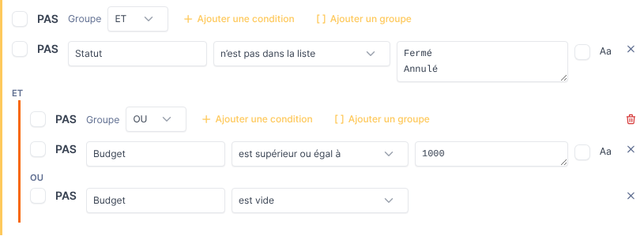

# Entity Sync — Guide d'installation et de paramétrage

*[English version](../en/installation.md)*

Ce guide s'adresse aux administrateurs GLPI : installation du plugin, attribution des
droits et paramétrage des modèles d'import. Le lancement des imports est décrit dans le
[guide utilisateur](guide-utilisateur.md).

- [Prérequis](#prérequis)
- [Installation](#installation)
- [Mise à jour](#mise-à-jour)
- [Désinstallation](#désinstallation)
- [Tâche de fond (cron GLPI)](#tâche-de-fond-cron-glpi)
- [Réglages du serveur](#réglages-du-serveur)
- [Droits](#droits)
- [Paramétrer un modèle d'import](#paramétrer-un-modèle-dimport)
- [Exemple complet](#exemple-complet)
- [Avant le premier import](#avant-le-premier-import)
- [Résolution de problèmes](#résolution-de-problèmes)

## Prérequis

| Composant | Version |
|---|---|
| GLPI | 11.0.x (testé avec 11.0.0 et 11.0.11) |
| PHP | Les versions prises en charge par votre version de GLPI (8.2 ou plus), avec les extensions `mbstring` et `intl` (déjà exigées par GLPI) |
| Base de données | Celle utilisée par GLPI (MariaDB ou MySQL) |
| Cron GLPI | **Lancé par le système** (crontab ou timer systemd), voir [tâche de fond](#tâche-de-fond-cron-glpi) : les imports sont appliqués par une action automatique de GLPI |

## Installation

1. Téléchargez `entitysync-<version>.tar.gz` depuis la page des versions (*releases*)
   du dépôt et, si vous le souhaitez, vérifiez-le avec le fichier `.sha256` :

   ```sh
   sha256sum -c entitysync-<version>.tar.gz.sha256
   ```

2. Décompressez-le dans le répertoire `plugins/` de GLPI. Le répertoire **doit**
   s'appeler `entitysync` :

   ```sh
   tar -xzf entitysync-<version>.tar.gz -C /var/www/glpi/plugins/
   chown -R www-data:www-data /var/www/glpi/plugins/entitysync   # utilisateur du serveur web
   ```

3. Installez et activez le plugin, soit dans *Configuration > Plugins* (boutons
   *Installer* puis *Activer*), soit en console, avec l'utilisateur du serveur web :

   ```sh
   cd /var/www/glpi
   sudo -u www-data php bin/console plugin:install entitysync --username=<login admin>
   sudo -u www-data php bin/console plugin:activate entitysync
   ```

4. Vérifiez que le cron de GLPI est lancé par le système (voir
   [tâche de fond](#tâche-de-fond-cron-glpi)) : sans lui, les imports restent en
   attente.

L'installation crée quatre tables (`glpi_plugin_entitysync_models`, `_links`, `_runs`,
`_jobs`), le droit du plugin, l'action automatique `entitysyncApply` et le répertoire
`files/_plugins/entitysync`. Les profils qui peuvent modifier la configuration de GLPI
(Super-Admin par défaut) reçoivent tous les droits du plugin ; les autres profils n'en
reçoivent aucun.

Le menu se trouve dans *Administration > Import d'entités*.

## Mise à jour

1. Remplacez le répertoire `plugins/entitysync` par la nouvelle version (même nom de
   répertoire).
2. Dans *Configuration > Plugins*, le plugin apparaît comme à mettre à jour : lancez la
   mise à jour, puis activez-le. En console :

   ```sh
   sudo -u www-data php bin/console plugin:install entitysync --username=<login admin> --force
   sudo -u www-data php bin/console plugin:activate entitysync
   ```

Les modèles, les entités gérées et l'historique sont conservés.

**De 1.0.x vers 1.1.0** : la mise à jour ajoute la table `glpi_plugin_entitysync_jobs`,
une colonne `status` à l'historique et l'action automatique `entitysyncApply`. Depuis
la 1.1.0, les imports sont appliqués en arrière-plan : configurez le cron de GLPI
(section suivante) avant le premier import.

## Désinstallation

La désinstallation du plugin (*Configuration > Plugins > Désinstaller*) supprime ses
tables et ses droits : les modèles, les liens entre modèles et entités et l'historique
des imports sont perdus. **Les entités créées par le plugin restent dans GLPI** comme
des entités ordinaires.

## Tâche de fond (cron GLPI)

Quand un utilisateur applique une prévisualisation, le plugin met en file un **travail
d'import**. L'action automatique GLPI **`entitysyncApply`** applique les travaux en
attente par lots :

- chaque exécution dure au plus 50 secondes, puis le travail continue à l'exécution
  suivante ;
- la progression est enregistrée après chaque lot : une exécution interrompue reprend
  là où elle s'est arrêtée ;
- le plan est recalculé à partir de l'état actuel de GLPI à chaque exécution ;
- l'action supprime aussi les prévisualisations non appliquées au bout de 24 heures.

GLPI 11 ne lance les actions automatiques en mode *GLPI* qu'à l'affichage de la page de
connexion, ce qui ne suffit pas pour une tâche de fond. L'action est donc installée en
mode **CLI**, et le cron de GLPI doit être lancé par le système toutes les minutes, avec
l'utilisateur du serveur web :

```cron
* * * * * www-data php /var/www/glpi/front/cron.php
```

(un timer systemd convient aussi). Vérifiez l'action dans *Configuration > Actions
automatiques > entitysyncApply* :

| Champ | Valeur |
|---|---|
| Statut | Programmée |
| Mode d'exécution | CLI |
| Fréquence d'exécution | 1 minute (par défaut) |
| Nombre d'opérations par lot | 100 par défaut. Un lot plus grand enregistre la progression moins souvent ; un lot plus petit donne une barre de progression plus fine. |

Le bouton *Exécuter* de cette page la lance une fois à la main. À titre d'ordre de
grandeur, une exécution a appliqué environ 1 300 créations en 8 secondes sur une
instance de test (mesure, dépend du serveur). La page de suivi d'un import affiche un
avertissement quand l'action n'a pas tourné 3 minutes après la mise en file.

## Réglages du serveur

| Réglage | Pourquoi |
|---|---|
| `upload_max_filesize`, `post_max_size` (PHP) | Taille maximale du fichier CSV. L'onglet Import affiche la limite en vigueur. |
| `memory_limit` (PHP) | Le fichier est chargé entièrement en mémoire. À titre d'ordre de grandeur, le moteur a utilisé environ 110 Mo pour 50 000 lignes lors d'un test (estimation, dépend du nombre de colonnes). |
| Délais du serveur web | Seule la prévisualisation est calculée dans une requête web (environ 1,6 s pour 1 200 lignes mesurées sur une instance de test) ; les modifications sont appliquées par la tâche de fond, les imports ne sont donc pas limités par `fastcgi_read_timeout`, `request_terminate_timeout` ou équivalents. |
| `max_input_vars` (PHP) | Aucune contrainte depuis la 1.1.0 : la sélection est envoyée par de petits appels AJAX, et non comme un champ de formulaire par modification. |
| `files/_plugins/entitysync` (GLPI) | Fichiers envoyés et instantanés de prévisualisation des travaux. Doit être accessible en écriture au serveur web **et** à l'utilisateur qui lance le cron (normalement le même). Les fichiers sont supprimés à la fin du travail. |

## Droits

Le plugin ajoute un onglet **Import d'entités** aux profils (*Administration > Profils
> (profil) > Import d'entités*) :

| Droit | Permet de |
|---|---|
| Lecture | Voir les modèles, leurs entités gérées et leur historique |
| Créer / Mettre à jour / Supprimer définitivement | Gérer les modèles |
| Appliquer un import | Envoyer un fichier, prévisualiser et appliquer les modifications |

L'application d'un import vérifie aussi les droits de l'utilisateur sur les
**entités** :

| Opération | Droit requis sur les entités |
|---|---|
| Ajout | Créer et Mettre à jour |
| Rattachement, modification | Mettre à jour |
| Suppression | Supprimer définitivement |

et exige un accès **récursif** à l'entité racine cible du modèle. La prévisualisation
affiche comme bloquées, avec la raison, les opérations que l'utilisateur n'a pas le
droit d'appliquer. La tâche de fond n'a pas de session utilisateur : les droits de
l'utilisateur sont vérifiés à la mise en file de l'import et conservés avec le travail.

## Paramétrer un modèle d'import

Créez un modèle dans *Administration > Import d'entités > Ajouter*. Le formulaire a
quatre parties.

### Général

| Champ | Description |
|---|---|
| Nom | Nom du modèle. |
| Entité racine cible | Les entités sont créées et gérées sous cette entité. Ce peut être l'entité racine ou n'importe quelle sous-entité. |
| Commentaires | Texte libre. |

### Fichier CSV

| Champ | Description |
|---|---|
| Séparateur | *Automatique* (détecté sur la première ligne parmi `;`, `,`, tabulation et `\|`), ou imposé. |
| Encodage | *Automatique* (UTF-8 si le fichier est en UTF-8 valide, Windows-1252 sinon), ou imposé (UTF-8, Windows-1252, ISO-8859-1, ISO-8859-15). Un BOM UTF-8 est ignoré. |
| Délimiteur de texte | Caractère qui entoure les valeurs contenant le séparateur (`"` par défaut). Un guillemet dans une valeur s'écrit deux fois. |

La première ligne du fichier doit contenir les noms des colonnes. Ils doivent être
uniques et non vides. Les valeurs sont débarrassées des espaces de début et de fin, et
les lignes vides sont ignorées. Les noms de colonnes sont sensibles à la casse ; dès
qu'un fichier a été envoyé, les éditeurs proposent ses noms de colonnes.

### Niveaux


Les niveaux sont ordonnés du haut (niveau 1, directement sous l'entité racine cible)
vers le bas. Les flèches permettent de les réordonner.

| Réglage | Description |
|---|---|
| Libellé du niveau | Nom du niveau, utilisé dans les messages et dans le nom par défaut des valeurs vides. |
| Colonnes clés | Une ou plusieurs colonnes qui identifient l'entité à ce niveau. Avec plusieurs colonnes (par exemple *Pays* + *Ville*), la clé est la combinaison de leurs valeurs. La clé doit être stable dans le temps : si elle change, le plugin voit une autre entité. |
| Colonne du nom | Colonne qui donne le nom de l'entité dans GLPI. Vide : les valeurs de la clé, jointes par ` - `. Si la colonne du nom est vide sur une ligne, la clé est utilisée. |
| Nom si vide | Nom de l'entité créée quand ce niveau est vide sur une ligne alors qu'un niveau inférieur est renseigné. Par défaut : *Sans &lt;niveau&gt;* (par exemple *Sans site*). |
| Règles de remplacement du nom | Expressions régulières appliquées dans l'ordre au nom (voir ci-dessous). |
| Colonnes du commentaire | Chaque colonne ajoute une ligne `Libellé: valeur` au commentaire de l'entité, dans l'ordre de la liste. *Ignorer les valeurs vides* omet les lignes dont la valeur est vide. **Sans colonne de commentaire, le plugin ne gère pas le commentaire** : les commentaires existants ne sont jamais écrasés. |

**Règles de remplacement.** Chaque règle a un *motif*, un *remplacement* et des
*options* facultatives. Le motif est une expression régulière PCRE écrite **sans
délimiteurs** ; les options sont parmi `i` (insensible à la casse), `m`, `s`, `x` et
`U` ; l'Unicode est toujours activé. Le remplacement peut réutiliser les groupes
capturés avec `$1`, `$2`… Les espaces sont normalisés après les règles (pas d'espace
double, ni en début ou en fin). Le champ *Valeur d'essai* sous les règles affiche le
résultat pendant la saisie (calculé par le navigateur, qui peut différer du serveur
pour une syntaxe avancée).

| Objectif | Motif | Options | Remplacement | Exemple |
|---|---|---|---|---|
| Retirer un préfixe | `^SITE[-_ ]` | `i` | *(vide)* | `site_Lyon` → `Lyon` |
| Retirer un code entre parenthèses | `\s*\([^)]*\)$` | | *(vide)* | `Paris Nord (PAR01)` → `Paris Nord` |
| Réordonner des parties | `^(\S+) - (.+)$` | | `$2 ($1)` | `FR75 - Paris` → `Paris (FR75)` |
| Remplacer les tirets bas par des espaces | `_` | | ` ` *(un espace)* | `Data_Center_Est` → `Data Center Est` |
| Retirer les zéros de tête | `^0+` | | *(vide)* | `00042` → `42` |

Un nom vide après les règles, ou de plus de 255 caractères, met la ligne en erreur.

### Filtre



Le filtre sélectionne les lignes du fichier à importer. C'est un arbre de **groupes**
et de **conditions** :

- un groupe combine ses éléments avec **ET** ou **OU** ; *Ajouter un groupe* imbrique
  un groupe, par exemple *A ET (B OU C)* ;
- **PAS** inverse un groupe ou une condition ;
- une condition compare une **colonne** à une ou plusieurs **valeurs** (une par ligne)
  avec un **opérateur** ; *Aa* la rend sensible à la casse (insensible par défaut).

| Opérateur | Vrai quand la cellule… |
|---|---|
| est égal à / est différent de | est égale / différente de la valeur (comparaison numérique si les deux sont des nombres) |
| est dans la liste / n'est pas dans la liste | vaut l'une / aucune des valeurs |
| contient / ne contient pas | contient / ne contient pas la valeur |
| commence par / se termine par | commence / se termine par la valeur |
| correspond à l'expression régulière | correspond à l'expression PCRE (sans délimiteurs) |
| est supérieur / inférieur à (ou égal à) | compare comme des nombres si les deux sont des nombres (`1,5` et `1.5` acceptés), comme des dates pour `AAAA-MM-JJ` et `JJ/MM/AAAA` (heure facultative), comme du texte sinon |
| est vide / n'est pas vide | est vide / non vide (pas de valeur à saisir ; une colonne absente compte comme vide) |

Avec plusieurs valeurs, un opérateur positif est vrai si **l'une** des valeurs
correspond ; un opérateur négatif (*est différent de*, *n'est pas dans la liste*, *ne
contient pas*) est vrai si **aucune** valeur ne correspond. Un filtre sans condition
conserve toutes les lignes.

**Les lignes écartées par le filtre comptent comme absentes du fichier** : les entités
qu'elles produisaient sont proposées à la suppression. Modifiez un filtre avec
prudence sur un modèle déjà utilisé.

Le modèle est validé à l'enregistrement : colonnes clés manquantes, expressions
régulières invalides ou conditions incomplètes sont signalées et le modèle n'est pas
enregistré. Les noms de colonnes sont vérifiés par rapport au fichier à chaque import.

## Exemple complet

Fichier `projets.csv` :

```csv
Organisation;Site;Code projet;Projet;Responsable;Budget;Statut
ACME;SITE-Paris;P001;Migration K8s;Alice;5000;Actif
ACME;SITE-Paris;P002;Refonte SI;Alice;1500;Actif
ACME;;P003;Projet orphelin;Alice;;Actif
ACME;site_Lyon;P004;Datacenter;Alice;20000;Fermé
Globex;Nantes;;;Bob;;Actif
Globex;Nantes;P005;Petit projet;Bob;200;Actif
```

Modèle (la configuration visible sur les captures ci-dessus) :

| Niveau | Clé | Nom | Règles | Commentaire |
|---|---|---|---|---|
| Organisation | `Organisation` | (clé) | | `Responsable` |
| Site | `Site` | (clé) | `^SITE[-_ ]` → *(vide)*, option `i` | |
| Projet | `Code projet` | `Projet` | | `Code projet` (libellé *Code*), `Budget` |

Filtre : `Statut` *n'est pas dans la liste* `Fermé`, `Annulé` **ET** (`Budget` *est
supérieur ou égal à* `1000` **OU** `Budget` *est vide*).

Résultat sous l'entité racine cible :

```text
ACME                               Responsable: Alice
├── Sans site
│   └── Projet orphelin            Code: P003
└── Paris
    ├── Migration K8s              Code: P001 / Budget: 5000
    └── Refonte SI                 Code: P002 / Budget: 1500
Globex                             Responsable: Bob
└── Nantes
```

La ligne 5 (`Fermé`) et la ligne 7 (budget 200) sont écartées par le filtre ; la
ligne 4 n'a pas de site, d'où la création de *Sans site* ; la ligne 6 n'a pas de
projet, elle s'arrête donc à *Nantes*.

## Avant le premier import

- Essayez le modèle sur une instance de test, ou avec une entité racine cible de test,
  avant de l'utiliser sur l'arborescence de production.
- Si l'arborescence existe déjà dans GLPI, vérifiez la section *Rattachements* de la
  première prévisualisation : les entités existantes de même nom sont reprises au lieu
  d'être dupliquées.
- Ne donnez le droit *Appliquer un import* qu'aux personnes responsables du
  référentiel.

## Résolution de problèmes

| Symptôme | Cause et solution |
|---|---|
| *Niveau « X » : la colonne « Y » n'existe pas dans le fichier* | Les noms de colonnes sont sensibles à la casse et doivent correspondre exactement à l'en-tête. Vérifiez le séparateur si tout l'en-tête est lu comme une seule colonne. |
| Les caractères accentués sont illisibles | Indiquez explicitement l'encodage dans le modèle (Windows-1252 pour un fichier enregistré par Excel sous Windows, par exemple). |
| *Vous devez avoir un accès récursif à l'entité racine cible* | Placez-vous sur l'entité cible (ou un parent) avec l'option *récursif* dans le sélecteur d'entité, ou donnez au profil un accès récursif sur cette entité. |
| *Cet import a expiré* / *Cet import n'existe plus* | La prévisualisation a été annulée, ou supprimée au bout de 24 heures sans avoir été appliquée. Renvoyez le fichier. |
| L'import reste *En attente de la tâche de fond* | Le cron de GLPI n'est pas lancé par le système, ou l'action `entitysyncApply` est désactivée ou en mode *GLPI*. Voir [tâche de fond](#tâche-de-fond-cron-glpi) ; le bouton *Exécuter* de l'action la lance une fois. |
| *Un autre import de ce modèle est en attente ou en cours* | Un seul import par modèle tourne à la fois. Attendez sa fin (sa page de suivi est en lien), ou arrêtez-le. |
| Un fichier de plus de 1 000 modifications ne peut pas être appliqué (HTTP 400) | Version 1.0.x du plugin : mettez à jour en 1.1.0 ou plus. |
| Une suppression est bloquée : *Contient encore…* | L'entité contient encore des éléments (ordinateurs, tickets, habilitations d'utilisateurs…). Déplacez-les ou supprimez-les, puis relancez l'import. |
| Une ligne est en erreur : *le nom « X » est déjà produit par une autre clé* | Deux clés différentes donnent le même nom sous le même parent, ce que GLPI interdit. Corrigez les données source, ou changez la colonne du nom ou les règles. |
| L'entité n'est pas rattachée : *déjà gérée par un autre modèle d'import* | Deux modèles visent les mêmes entités. Chaque entité ne peut être gérée que par un seul modèle. |
| La prévisualisation d'un très gros fichier est trop longue | Augmentez le délai du serveur web et `memory_limit`, ou appliquez les modifications en plusieurs fois : sélectionnez-en une partie (le champ de recherche aide, par exemple une organisation), appliquez, puis renvoyez le même fichier pour le reste. Ne découpez pas le fichier lui-même : les lignes absentes d'un fichier sont proposées à la suppression. |
